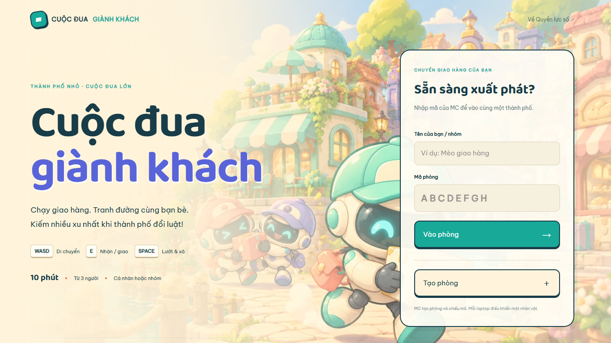
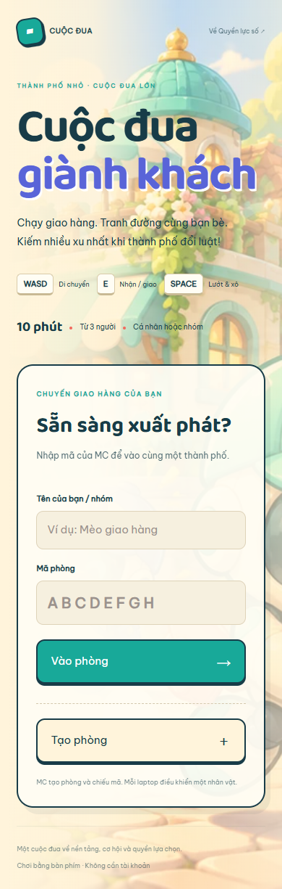
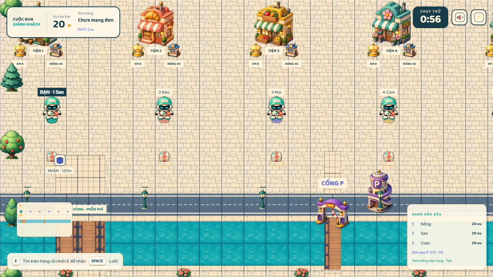
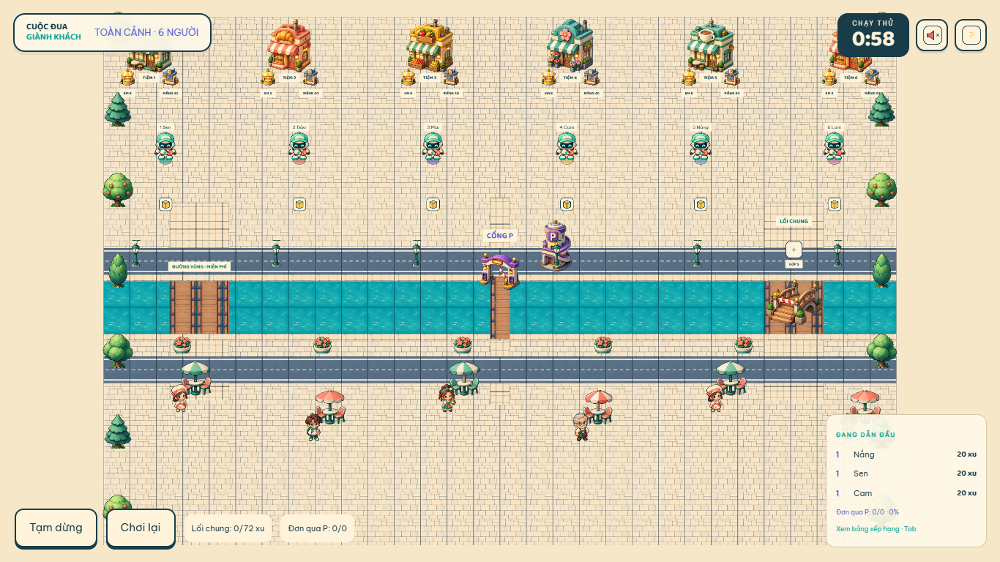
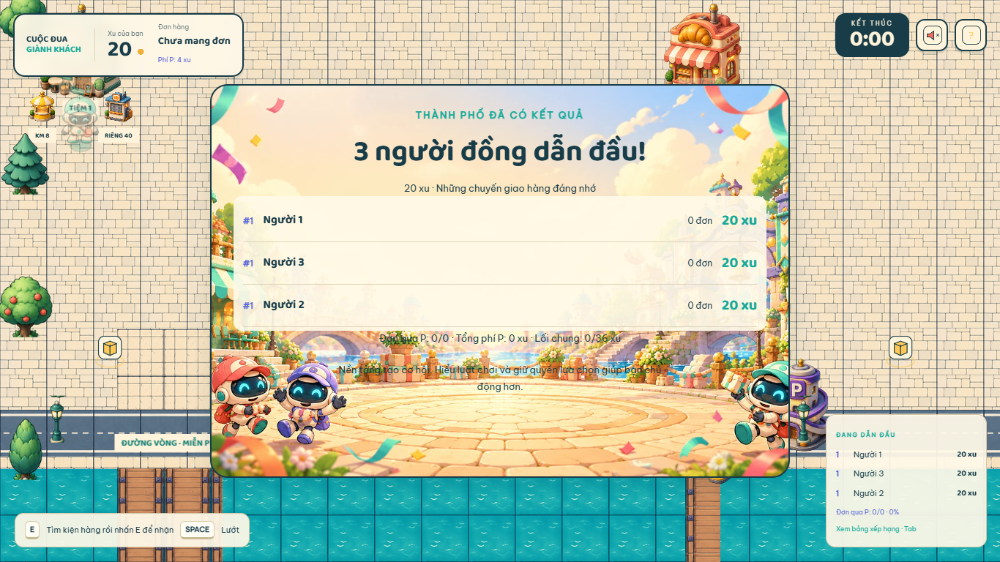

# Ảnh kiểm tra bản production

Ảnh chụp Chrome thật ở1366×768 và390×844, font đã tải, không có page error. Không phải mockup. Xem thêm `playtest-report.md` và `evidence/result-capture.json`.

## Sảnh

## Thành phố

Sáu danh tính bình thường tham gia qua HTTP/WebSocket, MC bắt đầu bằng lệnh thật. Các peer chỉ gửi input idle để giữ kết nối trong lúc chụp, không sửa vị trí/xu/đồng hồ. Ảnh chụp trong practice. Avatar/satchel/shadow/điểm nhận, nhà/collision, sông/cầu/cổng, nhãn Việt và HUD được quan sát trong engine.

## Kết quả

Phòng kết quả có sẵn từ A10 chạy600 giây thật. Đây là public viewer: panel phục hồi/kết nối được ẩn bằng CSS **chỉ cho ảnh trình bày**, không đổi state hoặc giờ của phòng. Ảnh gốc giữ nguyên panel tại [results-public-original.png](screenshots/results-public-original.png). Ảnh này không chứng minh quyền MC; quyền xuất CSV đã có A10 và kiểm tra role API.
